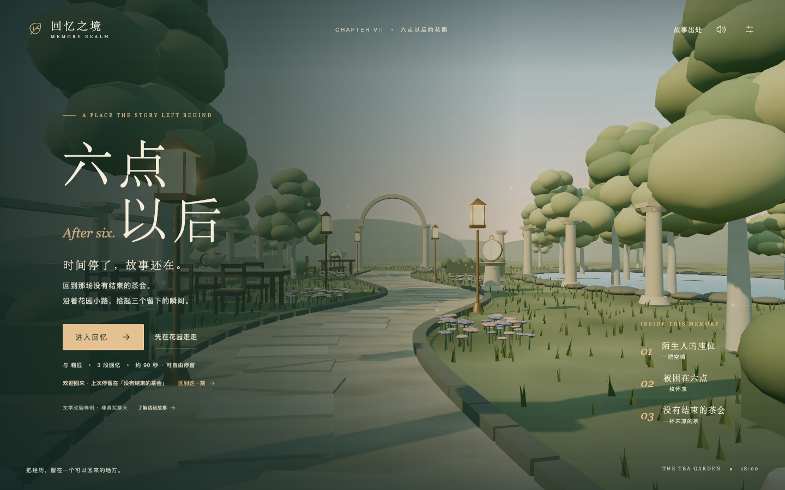

# Memory Lane

把用户与不同角色的聊天经历，变成可以探索、重温和收藏的三维回忆空间。

Memory Lane turns shared stories into walkable memories. The current prototype is a local, single-world experience; connected character worlds are planned for the hackathon version.

## 项目提案

从用户与不同角色的聊天记录中提取重要时刻，生成可探索的 3D 场景和回忆物件。用户沿路前行，在熟悉的对话、角色语音和背景音乐中重温共同经历，收藏珍贵瞬间。多个角色的世界在交界处交错相连，用户可以直接从一个世界走进另一个世界。

以上是产品目标，当前已实现的范围见下表。

| 能力 | 当前状态 |
| --- | --- |
| 单世界、三个回忆节点 | 已实现：六点以后 / After Six |
| 自动漫游、暂停与自由探索 | 已实现 |
| 原文查看、收藏与本地保存重访 | 已实现 |
| 本地环境音效 | 已实现，使用 Web Audio 合成 |
| 真实聊天导入与自动提取 | 计划中 |
| 多世界交界与连续行走 | 计划中 |
| 角色语音与背景音乐 | 计划中 |

当前样例改编自 Lewis Carroll《Alice’s Adventures in Wonderland》第七章“A Mad Tea-Party”，**是文学改编样例，非真实用户聊天**。三个节点为“陌生人的座位”“被困在六点”“没有结束的茶会”。节点与场景目前由人工编排，不是任意聊天自动生成系统。



## 新版入口：BLOODBOUND · 月下教堂

新版是第一人称、实时三维的可探索回忆：在月下教堂里遇险、获救、处理伤口、接受信物，片尾从东侧木门走过石砌走廊，到达通往下一世界的出口。剧情改编自用户提供的《BLOODBOUND — The Night You Were Mine》，是固定的文学样例，不是真实用户聊天。

需要 Node.js 22.12+ 与 npm（已在 Node.js 25.9.0 上验证），浏览器需要支持 WebGL2。

```sh
git clone http://10.110.10.9:3002/memory-lane.git
cd memory-lane
npm ci
npm run build:bloodbound
npm run start:bloodbound
```

打开 <http://127.0.0.1:4330/>。macOS 也可以双击 `打开 Bloodbound.command`。服务在后台运行，只监听本机，PID 写在 `.bloodbound.pid`。

开发模式：`npm run dev:bloodbound`，打开 <http://127.0.0.1:4331/bloodbound.html>；加 `?review=1` 可跳转章节并显示帧率。玩法、文件结构和接入方式见 [BLOODBOUND.md](BLOODBOUND.md) 与 [BLOODBOUND-INTEGRATION.md](BLOODBOUND-INTEGRATION.md)，素材来源见体验内的“制作与素材致谢”。

## 单世界原型：六点以后

```sh
npm ci
npm run build
npm start
```

打开 <http://127.0.0.1:4327/>。macOS 也可以双击 `打开 Memory Lane.command`。首次启动需要下载 npm 依赖；完成安装后，两个 Demo 运行时都不调用模型 API 或其他付费服务。

开发模式：`npm run dev`，同样使用 4327 端口。不要同时运行开发服务和后台服务。后台服务 PID 在 `.server.pid` 中；停止前应确认它仍对应本项目的 `scripts/server.mjs`。

## 原型操作

- “进入回忆”开始导览，行走约 64 秒，加上阅读约 90 秒；节点阅读时间由用户控制。
- WASD 移动；↑↓ 前后走，←→ 转向；按住画面拖动环顾。移动会接管导览。
- E 打开附近回忆；Esc 关闭回忆或暂停。
- 章节按钮可重访节点；“查看当时的对话”展示原文与演示译文。
- 收藏、访问进度、声音和画面设置保存在当前浏览器，不提供云端同步。

当前验收面向电脑浏览器；触屏自由移动尚未完成验收。

## 开发与检查

```sh
npm test
npm run build
npm run build:bloodbound
```

存档测试覆盖默认值、异常数据、保存重访与存储失败反馈，并校验英文引用在附带章节中存在。单世界原型经过独立 Agent 实际浏览器体验与问题复验。

- `src/story.js`：故事、回忆节点、原文和路线参数。
- `src/scene.js`：Three.js 场景、镜头、移动与碰撞。
- `src/main.js`：页面与体验流程。
- `src/storage.js`：经 Zod 校验的本地存档。
- `src/audio.js`：本地环境音效。
- `public/assets/`：随项目提供的素材与原文。
- `scripts/`：独立本地启动与静态服务。

单世界原型的历史存档键保留 `memory-realm`，兼容早期本地 Demo；服务健康标识为 `memory-realm-next`，BLOODBOUND 服务为 `memory-lane-bloodbound-next`。产品名称为 Memory Lane。

## 下一阶段

- 导入同一用户与两个角色的真实聊天，提取带原文出处的回忆。
- 构建两个各有 2–3 个节点的世界，以及一个可双向走过的交界。
- 增加与物件相关的轻交互，评估本地语音合成。
- 保留导览、自由探索、收藏和重访，用真实用户体验验证故事辨识度。

源码公开；真实聊天、密钥、运行日志、本地存档及内部评审记录不随仓库发布。导入数据请放在被忽略的 `imports/` 或 `private/` 中。

## 许可与内容来源

原创代码为 [MIT](LICENSE)。第三方模型、依赖和文学文本分别保留其许可，见 [素材来源与许可](ASSET-LICENSES.md)。

场景中的花园、道路、灯光和部分物件摆放是视觉演绎，中文为演示译文。原文与 Project Gutenberg 许可附在 `public/assets/`。
